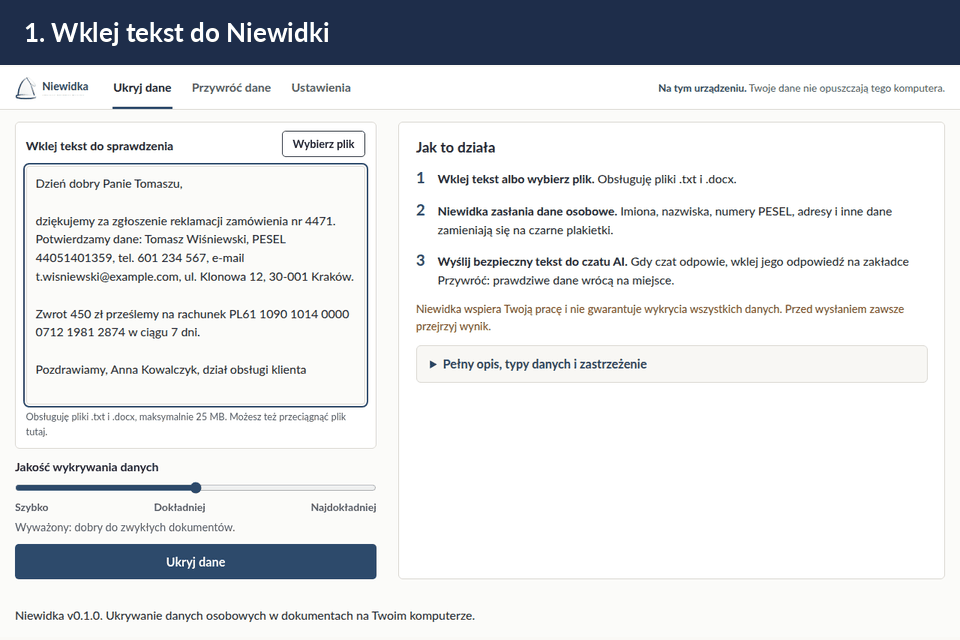

# Niewidka

**Polski** · [English](README.en.md) · [For Agents](AGENTS.md)



Niewidka ukrywa dane osobowe w polskich tekstach i dokumentach. Działa na Twoim komputerze.
Nic nie wysyła do internetu.

Wklej tekst albo wybierz plik `.txt` lub `.docx`. Program zamieni imiona, nazwiska, PESEL,
NIP, adresy, telefony, e-maile, numery kont i dokumentów na znaczniki, na przykład
`[OSOBA_1]` albo `[PESEL_1]`. Taki tekst możesz wysłać do dowolnego czatu AI, na przykład
z prośbą o zredagowanie albo poprawienie pisma.

**W poleceniu dla czatu dopisz, żeby nie usuwał ani nie zmieniał znaczników.** Program
wstawia prawdziwe dane tylko tam, gdzie znacznik został. Znacznika, który czat usunął albo
przerobił, nie da się z powrotem połączyć z danymi. Przykładowe polecenie:

> Zredaguj to pismo. Zostaw bez zmian wszystkie znaczniki w nawiasach kwadratowych,
> na przykład [OSOBA_1] albo [ADRES_1].

Odpowiedź z czatu wklej z powrotem do programu. Niewidka wstawi prawdziwe dane w miejsce
znaczników.

Niewidka pomaga, ale nie zastępuje człowieka. Przejrzyj podgląd przed wysłaniem tekstu.

## Wyniki testu

Test aktualnej wersji (gałąź `main` po wydaniu 0.2.0) na 30 realistycznych pismach z fikcyjnymi
danymi, poziom 2:

| Co sprawdzano | Ukryte |
|---|---|
| wszystkie 455 pozycji z listy | 443 (97,4%) |
| 447 prawdziwych danych osobowych | 443 (99,1%) |

Widoczne zostały 4 dane osobowe: dwa numery mieszkań bez ulicy („m. 10”), kod pocztowy
w nawiasie i skrzyżowanie ulic bez numeru. Tabela dla każdego pisma z listą danych, które
zostały widoczne: [`docs/WYNIKI-TESTOW.md`](docs/WYNIKI-TESTOW.md).

## Dwie wersje

| | Wersja okienkowa | Wersja w przeglądarce |
|---|---|---|
| Jak się uruchamia | `Niewidka.exe` | `python -m niewidka.api` i przeglądarka |
| Instalacja | rozpakowanie ZIP | Python 3.11 lub nowszy i narzędzie `uv` |
| Gdzie działa | Windows 10 i 11 | Windows, Linux, macOS |

Obie wersje wyglądają i działają tak samo. Program nasłuchuje tylko na Twoim komputerze
(`127.0.0.1`). Nikt z sieci się do niego nie podłączy.

Modele działają na każdym komputerze osobno albo na jednym serwerze w sieci lokalnej.
Przy wspólnym serwerze użytkownicy nie pobierają modeli. Opis dla administratora:
[`docs/SERWER-INFERENCJI.md`](docs/SERWER-INFERENCJI.md).

## Szybki start: wersja okienkowa

1. Pobierz plik `Niewidka-<wersja>-windows-x64.zip` ze strony wydań:
   <https://github.com/AuCourDe/niewidka/releases>.
2. Rozpakuj plik w dowolnym folderze i uruchom `Niewidka.exe`.
3. Kliknij „Utwórz klucz”. Klucz zapisze się w Menedżerze poświadczeń Windows.
4. Kliknij „Pobierz podstawowy (zalecane)”. Pakiet ma około 190 MB. Pobierasz go tylko raz.
5. Wklej tekst i kliknij „Ukryj dane”.

## Szybki start: wersja w przeglądarce

```bash
git clone https://github.com/AuCourDe/niewidka.git
cd niewidka
uv sync
uv run python -m niewidka.klucze do-keyringa
uv run python -m niewidka.api
```

Otwórz w przeglądarce <http://127.0.0.1:8390>. Przy pierwszym uruchomieniu pobierz pakiet
podstawowy. Port zmienisz zmienną `NIEWIDKA_PORT` albo w pliku `niewidka.toml`.

Linux bez pulpitu nie ma magazynu haseł. Zamiast `do-keyringa` utwórz plik klucza:

```bash
mkdir -p ~/.config/niewidka
uv run python -m niewidka.klucze nowy-plik ~/.config/niewidka/klucz
NIEWIDKA_KLUCZ_PLIK=~/.config/niewidka/klucz uv run python -m niewidka.api
```

## Co Niewidka ukrywa

Przykłady poniżej to prawdziwy wynik programu na poziomie 2. Dane w przykładach są fikcyjne.

| Dane | Przykład w tekście | Po ukryciu |
|---|---|---|
| imię i nazwisko, także w odmianie | „rozmawiałem z Janem Kowalskim, a potem Kowalski…” | „rozmawiałem z [OSOBA_1_F1], a potem [OSOBA_1_F2]…” |
| PESEL | PESEL: 44051401359 | PESEL: [PESEL_1] |
| NIP | NIP 526-025-02-74 | NIP [NIP_1] |
| REGON | REGON 123456785 | REGON [REGON_1] |
| numer konta | PL61 1090 1014 0000 0712 1981 2874 | [IBAN_1] |
| numer karty płatniczej | 4111 1111 1111 1111 | [KARTA_1] |
| dowód osobisty, paszport | Dowód osobisty ABA300000 | Dowód osobisty [DOKUMENT_1] |
| numer rejestracyjny, VIN, numer polisy | nr rej. WA 12345 | nr rej. [DOKUMENT_1] |
| adres | przy ul. Długiej 5/12, 00-950 Warszawa | przy [ADRES_1] |
| telefon | 501 234 567 | [TELEFON_1] |
| e-mail | jan.kowalski@poczta.pl | [EMAIL_1] |
| data | 14 maja 1944 r. | [DATA_1] r. |
| adres IP | 192.168.10.25 | [IP_1] |
| kod SWIFT, login | na poziomie 3 z pakietem rozszerzonym | [SWIFT_1], [LOGIN_1] |
| Twoje własne słowa | „Ukryj wszędzie” albo stała lista w ustawieniach | [INNE_1] |

Ta sama osoba ma zawsze ten sam numer, a każda forma odmiany dostaje własną końcówkę `_F1`,
`_F2`. Dzięki temu program przywraca dokładnie tę formę, która stała w tekście. PESEL, NIP,
REGON, numer konta, karty i dowodu program sprawdza cyfrą kontrolną. Numer z błędną cyfrą
też ukrywa, bo w pismach zdarzają się literówki.

Trzy poziomy jakości różnią się szybkością i dokładnością. Po ukryciu niezależna kontrola
czyta wynik jeszcze raz i wskazuje miejsca, które nadal wyglądają na dane osobowe.

Mapa, która łączy znaczniki z prawdziwymi danymi, jest zaszyfrowana AES-256 i leży na Twoim
komputerze. Klucz jest w systemowym magazynie haseł albo w pliku wskazanym przez dział IT.

## Dokumentacja

- [`docs/PRZEWODNIK.md`](docs/PRZEWODNIK.md): co program umie, jak działa i jak go wdrożyć.
- [`docs/INSTRUKCJA.md`](docs/INSTRUKCJA.md): obsługa programu krok po kroku.
- [`docs/KONFIGURACJA.md`](docs/KONFIGURACJA.md): wszystkie ustawienia, plik `niewidka.toml` i zmienne środowiskowe.
- [`docs/SERWER-INFERENCJI.md`](docs/SERWER-INFERENCJI.md): wspólny serwer modeli w sieci lokalnej.
- [`docs/MODELE.md`](docs/MODELE.md): modele, poziomy jakości i wyniki pomiarów.
- [`docs/WYNIKI-TESTOW.md`](docs/WYNIKI-TESTOW.md): test na 30 pismach, co program ukrywa, a czego nie.
- [`docs/LICENCJE.md`](docs/LICENCJE.md): licencje modeli i bibliotek.
- [`docs/WYDANIE.md`](docs/WYDANIE.md): wydawanie i podpisywanie pakietów modeli.

## Budowa programu ze źródeł (Windows)

Potrzebujesz Windows 10 lub 11, Pythona 3.13 (`py -3.13`) i programu Git.

```powershell
git clone https://github.com/AuCourDe/niewidka.git C:\niewidka-zrodla
cd C:\niewidka-zrodla
powershell -ExecutionPolicy Bypass -File narzedzia\zbuduj_windows.ps1 -KatalogBudowy C:\niewidka-build
```

Skrypt zainstaluje zależności, uruchomi testy i zbuduje `Niewidka.exe` oraz paczkę ZIP.
Paczka nie zawiera modeli. Program pobierze je przy pierwszym uruchomieniu.

Testy: `uv run pytest`. Sprawdzenie kodu: `uv run ruff check`.

## Licencja

Kod programu jest na licencji MIT (`LICENSE`). Możesz go używać, zmieniać i rozpowszechniać,
także komercyjnie. Licencja MIT nie obejmuje modeli. Modele pobierasz osobno
i obowiązują je licencje ich twórców: pakiet podstawowy Apache 2.0, pakiet rozszerzony
LFM Open License v1.0, która ogranicza użycie komercyjne. Szczegóły: [`docs/LICENCJE.md`](docs/LICENCJE.md).

Program używa modeli statystycznych i nie wykrywa wszystkich danych osobowych w każdym
tekście. Przed przekazaniem dokumentu dalej sprawdź wynik. Autor nie odpowiada za skutki
niepełnego ukrycia danych. Luki w zabezpieczeniach zgłaszaj według `SECURITY.md`.
